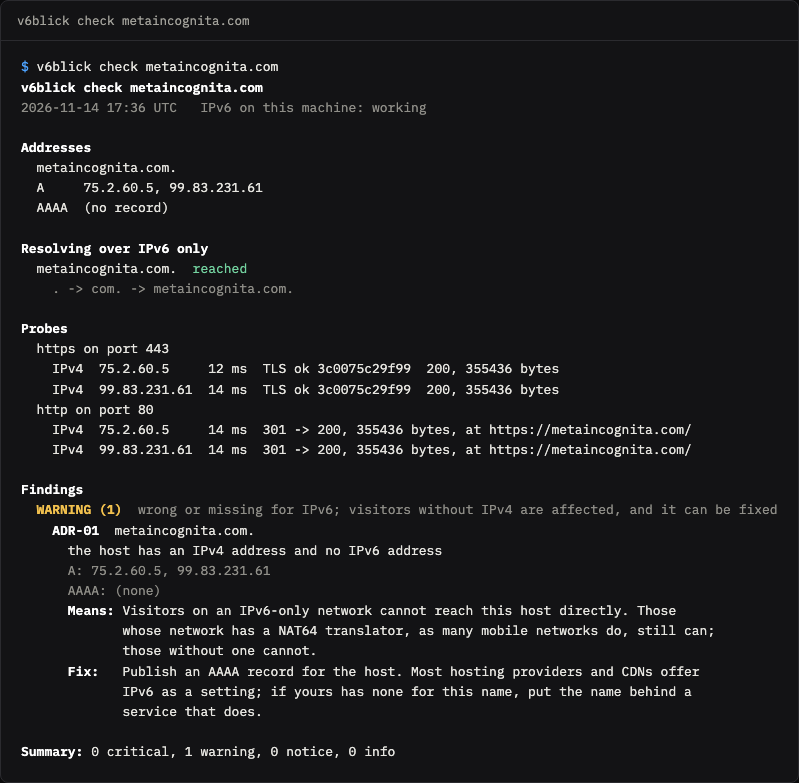
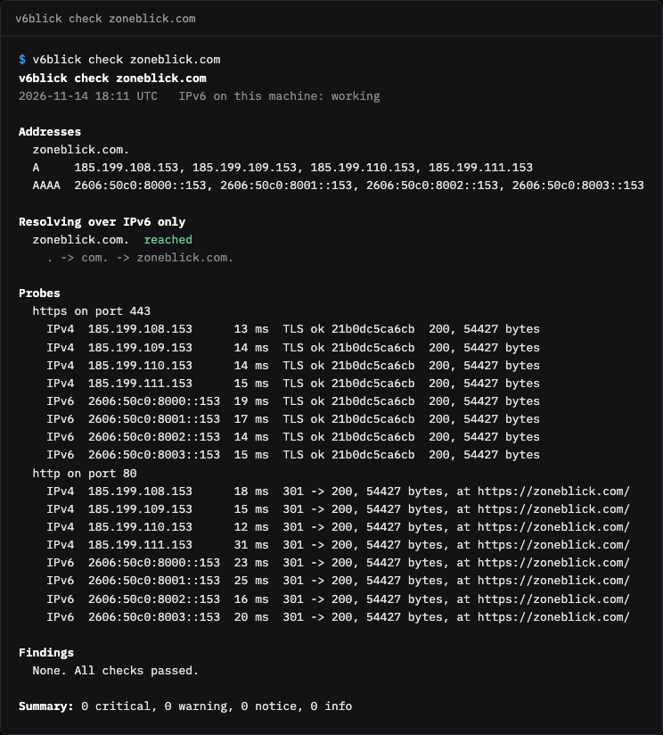

# v6blick

Does your site work for someone who has no IPv4?

v6blick answers that in two ways. `v6blick check` connects to a site over IPv4 and over IPv6 separately, compares the two, and reports what breaks for a visitor without IPv4. `v6blick page` loads the whole page in a real browser, once on an ordinary connection and once on an IPv6-only network, and names every part of it that does not arrive, down to the one third-party script that has no IPv6 address. Each finding says what it means and how to fix it. Still planned: a third kind of network, IPv6-only with a NAT64 translator, as on many mobile networks.

**Status:** early. Phases 0 and 1 work. `v6blick check` looks a host up, connects to it over IPv4 and over IPv6 separately and compares the two, with ten checks. `v6blick page` loads a page in an installed Chrome or Chromium through a local proxy that takes IPv4 away, with four checks. `v6blick doctor` says whether this machine can run them. Both print text or JSON and exit with a code for CI. The NAT64 mode, the literal-address checks and the HTML report are designed and not built; sections below say which parts are planned. There are no ready-built binaries yet: build it from source. The page test is newer than the security audit below and has not been audited.

- Website: https://cschweda.github.io/v6blick/
- Design document: [DESIGN.md](DESIGN.md)
- Decisions made while building: [DECISIONS.md](DECISIONS.md)
- Companion project: [zoneblick](https://zoneblick.com), which watches DNS zones over time
- Who it is for, with the command for each case: [Who it is for](#who-it-is-for)

## Contents

- [What it looks like](#what-it-looks-like)
- [Who it is for](#who-it-is-for)
- [Why this is needed](#why-this-is-needed)
- [Platforms](#platforms)
- [Install](#install)
- [Try it](#try-it)
- [What a finding tells you](#what-a-finding-tells-you)
- [Command reference](#command-reference)
- [JSON output](#json-output)
- [The three networks](#the-three-networks)
- [How it works](#how-it-works)
- [Safety and politeness](#safety-and-politeness)
- [How it divides the work with zoneblick](#how-it-divides-the-work-with-zoneblick)
- [Build phases](#build-phases)
- [Development](#development)
- [Repository layout](#repository-layout)
- [Security audits](#security-audits)
- [Responsible use](#responsible-use)
- [Privacy](#privacy)
- [License](#license)

## What it looks like

Real output, for the author's own sites, on 14 November 2026.

`www.metaincognita.com` has IPv6 addresses and answers over them. It redirects to `metaincognita.com`, which has no AAAA record, so over IPv6 the visit ends at the redirect. A browser on a dual-stack connection never shows this, because it follows the redirect over IPv4:


The bare domain itself, which has two A records and no AAAA record:



A clean site. `zoneblick.com` has four addresses in each family, and all eight serve the same certificate, the same redirect and the same page:



The whole page, in a real browser. `v6blick page` loads it once on an ordinary connection and once without IPv4. Here the page itself never arrives on an IPv6-only network, because of the same redirect:


A page that loads alike in both. `zoneblick.com` asks three third parties for fonts and a script, and all of them have IPv6:


## Who it is for

Nine situations v6blick is designed for, each with the command that answers it. All work today except number 6, which needs the NAT64 mode of Phase 2.

**1. "We published an AAAA record last year. Does it still work?"** A dual-stack browser would hide a dead IPv6 address by falling back. `check` connects over each family on its own, so an address that no longer answers is a critical finding (RCH-01).

```
v6blick check metaincognita.com
```

**2. "Our IPv6 traffic goes through a different load balancer. Does it serve the same site?"** `check` compares the certificate, the status, the redirect and the body between the two families (EQV-01 to EQV-03). A stale certificate or an old redirect on the IPv6 side shows up here.

```
v6blick check https://www.metaincognita.com/
```

**3. "The site redirects. Does the redirect work without IPv4?"** Redirects are followed inside one address family, so a redirect to a name with no IPv6 address ends there, as it does for a visitor. This is the real finding for `www.metaincognita.com`, which has IPv6 addresses and redirects to a bare domain that has none (EQV-02).

```
v6blick check www.metaincognita.com
```

**4. "A pull request must not add something that breaks for IPv6-only visitors."** Run it in CI against the preview build. It exits `2` on a critical finding and `1` on warnings. The runner needs IPv6; GitHub's hosted runners have none by default (see [Platforms](#platforms)).

```yaml
- run: v6blick check --json -- "$PREVIEW_HOST" > v6blick.json
```

Put `--` before a host that comes from somewhere you do not control, such as a pull request. Without it, a "host" of `--help` would print the help text and exit `0`.

**5. "We want to stop paying for IPv4 addresses. What would break?"** `page` loads the page without IPv4 and lists every host it needs that has no working IPv6 address: the true dependency list.

```
v6blick page https://metaincognita.com
```

**6. "Most of our visitors are on mobile networks. What do they hit today?"** Planned. Many mobile networks are IPv6-only with a NAT64 translator. That rescues IPv4-only hostnames, and it does not rescue an IPv4 address written straight into a page or a script (LIT-01).

```
v6blick page https://metaincognita.com --mode nat64
```

**7. "Which of our third parties hold us back?"** A failure at a third party is a notice, not a warning, because the site owner cannot fix it, only replace or self-host it. The page report says for each host whether it is the page's own site or a third party, by the Public Suffix List, so the notices read as a list of suppliers to talk to.

```
v6blick page https://metaincognita.com --json | jq -r '.findings[] | select(.evidence.third_party) | .name'
```

**8. "I am testing a build on my own machine before it goes live."** Private and loopback addresses are refused by default, so a page cannot steer the tool at an internal host. One flag permits them.

```
v6blick check http://localhost:8080/ --allow-private
```

With `--allow-private`, a name the public DNS does not know, such as `localhost` or a name in your hosts file, is looked up with this machine's own resolver.

**9. "The check says IPv6 fails everywhere. Is it the sites, or is it this machine?"** `doctor` says whether this machine has working IPv6 and whether a Chrome or Chromium is installed. Without working IPv6, `check` says so and exits `3`; it never reports a site as broken because the test machine has no IPv6.

```
v6blick doctor
```

## Why this is needed

A growing share of clients have no IPv4 address of their own: many mobile networks, and a rising number of corporate and cloud networks now that providers charge for IPv4 addresses. They reach the IPv4 internet through a translator, or not at all.

The failures hide behind fallback. A browser on a dual-stack connection that cannot reach a site over IPv6 quietly retries over IPv4, so the site's owner never sees the fault. The owner's own connection is the one place where the problem cannot be seen.

The gap is wide. A 2025 study (Thottungal Valapu and Heidemann, "Towards a Non-Binary View of IPv6 Adoption") found that only 12.6% of the top 100,000 websites qualify as fully IPv6-ready, because the rest rely on IPv4-only resources. Internet Society Pulse measurements put IPv6 support at 67% for the domains pages are first loaded from, and at 47% for the third-party domains they depend on. A site can publish an AAAA record and still break, because a font, a script or a tracking pixel comes from a host that has none.

Existing tools leave a gap:

| Tool | What it does | What is missing |
|---|---|---|
| NAT64Check (Internet Society) | Loads a URL over IPv4, IPv6 and NAT64 and compares the results, including whether images, stylesheets and scripts load | A hosted service (2017, version 2 in 2019); running your own takes four servers |
| IETF 124 hackathon "IPv6 Web Resource Checker" (2025) | Checks a page's resources with a real browser | A hackathon project |
| test-ipv6.com and similar | Tells a visitor about their own connection | Tests the client, not the site |

v6blick is a tool you run yourself, against a local build or a live URL, that covers the whole page.

## Platforms

| | State |
|---|---|
| macOS | Developed and tested here |
| Linux | Written to work, and not yet run there. Nothing in the code is specific to macOS; the tests need `127.0.0.1` and `::1` |
| Windows | Untested. `doctor` knows where Chrome is installed on Windows; nothing else has been tried |

Two things v6blick needs from the machine it runs on:

- **Working IPv6.** Without it there is nothing to compare, and `check` exits `3` and says so. `v6blick doctor` tells you in a second.
- **A stable Rust toolchain, 1.88 or later**, to build it. There are no ready-built binaries yet.

`v6blick page` also needs **Chrome or Chromium** installed. v6blick looks in the usual places and on the search path, and `doctor` says what it found. `check` needs no browser.

**GitHub's hosted runners have no IPv6 connectivity by default**, so `v6blick check` exits `3` there. In GitHub Actions, use a self-hosted runner on a machine that has IPv6. Other CI services differ; run `v6blick doctor` as the first step to find out.

## Install

There is one way to install v6blick today: build it from source with cargo. It takes about a minute.

**Not available yet:** ready-built binaries, an install script, a Homebrew formula, `.deb` and `.rpm` packages, a Docker image and a GitHub Action. They belong to the packaging phase ([Build phases](#build-phases), Phase 5).

### Build with cargo

Needs a stable [Rust toolchain](https://rustup.rs), version 1.88 or later. Builds the latest source and puts the `v6blick` binary in `~/.cargo/bin`, which rustup adds to your PATH.

```
cargo install --git https://github.com/cschweda/v6blick
v6blick --version
```

### One exact version

`v0.1.0` is the tag of Phase 0, after its security audit. Pinning the tag pins what you run.

```
cargo install --git https://github.com/cschweda/v6blick --tag v0.1.0
```

### From a clone

The same result from a local checkout, if you want to read or change the code first.

```
git clone https://github.com/cschweda/v6blick
cd v6blick
cargo install --path .
```

Or run it without installing:

```
cargo run -- check metaincognita.com
```

### In a CI workflow

Build it in the job, check that the runner has IPv6, then check the host. The exit code follows severity: `1` for notices or warnings, `2` for a critical finding, `3` when the run itself failed.

```yaml
- run: cargo install --git https://github.com/cschweda/v6blick --tag v0.1.0
- run: v6blick doctor
- run: v6blick check --json -- "$PREVIEW_HOST" > v6blick.json
```

Put `--` before a host that comes from somewhere you do not control, such as a pull request. Without it, a "host" of `--help` would print the help text and exit `0`. See [Platforms](#platforms) for runners without IPv6.

### Update or remove

Run the install again with `--force` to update. It is one binary, so removing it leaves nothing behind.

```
cargo install --force --git https://github.com/cschweda/v6blick
cargo uninstall v6blick
```

## Try it

Every command here works today, and every output shown is real, from 14 November 2026.

**1. Can this machine run the check?** The IPv6 address below is from the range reserved for documentation; yours will be your own.

```
$ v6blick doctor
v6blick doctor

  IPv4    working    a root server answered over IPv4
  IPv6    working    a root server answered over IPv6
                     this machine's IPv6 address is 2001:db8:42::1c
  Chrome  found      /Applications/Google Chrome.app/Contents/MacOS/Google Chrome

This machine can run `v6blick check`.
```

**2. Check a host.** A bare name is probed on port 443 and on port 80, at every address, at most four per family. The full output is in the screenshots [above](#what-it-looks-like).

```
$ v6blick check metaincognita.com
...
Findings
  WARNING (1)  wrong or missing for IPv6; visitors without IPv4 are affected, and it can be fixed
    ADR-01  metaincognita.com.
      the host has an IPv4 address and no IPv6 address
      A: 75.2.60.5, 99.83.231.61
      AAAA: (none)
      Means: Visitors on an IPv6-only network cannot reach this host directly. Those
             whose network has a NAT64 translator, as many mobile networks do, still can;
             those without one cannot.
      Fix:   Publish an AAAA record for the host. Many hosting providers and CDNs offer
             IPv6 as a setting; if yours has none for this name, put the name behind a
             service that does.

Summary: 0 critical, 1 warning, 0 notice, 0 info
```

**3. Check one address, as given.** A full address is probed with its own scheme, port and path, and nothing else.

```
$ v6blick check https://www.metaincognita.com/
```

**4. Use the exit code.** `0` is clean, `1` notices or warnings, `2` a critical finding, `3` a failed run.

```
$ v6blick check zoneblick.com > /dev/null; echo $?
0
$ v6blick check metaincognita.com > /dev/null; echo $?
1
```

**5. One line per finding, from the JSON.** With [`jq`](https://jqlang.org):

```
$ v6blick check www.metaincognita.com --json | jq -r '.findings[] | "\(.severity)  \(.check_id)  \(.summary)"'
warning  EQV-02  https://www.metaincognita.com/ redirects to https://metaincognita.com/, which works over IPv4 and fails over IPv6
```

**6. Only what to do about it.**

```
$ v6blick check metaincognita.com --json | jq -r '.findings[] | .fix'
Publish an AAAA record for the host. Many hosting providers and CDNs offer IPv6 as a setting; if yours has none for this name, put the name behind a service that does.
```

**7. A build on your own machine.** Private and loopback addresses are refused unless you permit them. With the flag, a name the public DNS does not know, such as `localhost`, is looked up with this machine's own resolver.

```
$ v6blick check http://localhost:8080/ --allow-private
```

**8. Load a whole page.** In an installed Chrome or Chromium, once on an ordinary connection and once without IPv4. It needs no setup: the browser gets a fresh profile, which is deleted afterwards.

```
$ v6blick page www.metaincognita.com
v6blick page https://www.metaincognita.com/
2026-11-14 18:49 UTC   IPv6 on this machine: working   Chrome/157.0.8103.51

Page loads
  dual      11 requests    11 ok
  v6only     2 requests     1 ok     1 failed
  first view only: what the page loads on a click or a scroll is not seen

Hosts in v6only
  metaincognita.com      own site       0 ok    1 failed   metaincognita.com has no IPv6 address
  www.metaincognita.com  own site       1 ok

Findings
  CRITICAL (1)  broken now for visitors who use IPv6; fix it first
    PGE-01  metaincognita.com
      the page cannot be loaded on an IPv6-only network: it redirects to https://metaincognita.com/,
      and metaincognita.com has no IPv6 address
...
$ echo $?
2
```

A page run takes about seven seconds for a small page: two browser starts and two page loads.

**How long, and how much traffic.** A check takes from one to about five seconds. Measured: `metaincognita.com` took 9 DNS queries and 6 requests in under a second; `www.metaincognita.com`, an alias that redirects to another host, took 58 DNS queries and 16 requests in five seconds. Each address gets one `GET` on each port, and one more for each redirect that is followed.

## What a finding tells you

Every finding answers three questions: how bad is it, what does it mean for a visitor, and can it be fixed.

| Severity | What it means | Exit code |
|---|---|---|
| **critical** | Broken now for visitors who use IPv6: a published address that nothing answers, or a secure connection that fails over IPv6 only. Fix it first. | `2` |
| **warning** | Wrong or missing for IPv6. Visitors without IPv4 are affected, and it can be fixed. | `1` |
| **notice** | Worth a look. It may be harmless, or chance in one measurement. | `1` |
| **info** | For your information; nothing to fix. | `0` |

Under each finding the text output has two short paragraphs, `Means:` and `Fix:`. The JSON output has the same text as `meaning` and `fix`. Every finding of the ten `check` checks is about the site's own names and servers, so whoever runs its DNS or hosting can act on it. The page checks can also name a third party, which is theirs to fix and yours to replace. That may still mean changing a setting at a hosting or DNS provider, or moving away from one that has no IPv6.

| ID | What it means for visitors | How to fix it |
|---|---|---|
| ADR-01 | On an IPv6-only network they cannot reach the host directly. With a NAT64 translator, as on many mobile networks, they still can. | Publish an AAAA record. Many hosts and CDNs offer IPv6 as a setting. |
| ADR-02 | Clients that prefer IPv6 try this address first and fail. | Replace the record with the server's public IPv6 address, or remove it. |
| ADR-03 | A resolver that has only IPv6 cannot look the name up at all. | Give the zone's nameservers IPv6 addresses, or move the zone to a DNS host that has them. |
| RCH-01 | Visitors without IPv4 cannot reach the site; everyone else waits for the fallback. | Make the server listen on the address and open ports 80 and 443 over IPv6, or remove the AAAA record until it does. |
| RCH-02 | Visitors on IPv6 cannot open a secure connection. | Check the TLS setup of the IPv6 listener or load balancer. |
| RCH-03 | The site opens more slowly over IPv6. | Look at the route to the IPv6 address. Run the check again first: one measurement can be chance. |
| RCH-04 | A client without fast fallback waits before the page starts to load. | Fix or remove the AAAA record that does not answer. |
| EQV-01 | Visitors on IPv6 are shown another certificate, perhaps an expired one. | Install the same certificate on every server behind the AAAA records. |
| EQV-02 | Visitors on IPv6 get another answer: another page, an error, or a redirect that leads nowhere for them. | Serve the same configuration on the IPv6 side; give the target of a redirect an AAAA record. |
| EQV-03 | Visitors on IPv6 may be shown a different page. A page that changes on every load can cause this by chance. | Compare the two responses. |
| PGE-01 | On an IPv6-only network with no translator they do not get the page at all. | Give the page's host an IPv6 address, and every host it redirects through. |
| PGE-02 | The page loads, and a stylesheet, script, font or image from this host is missing. | For your own host, publish an AAAA record. For a third party, ask them, self-host the file, or change supplier. |
| PGE-03 | The host has an IPv6 address and what the page needs from it still does not arrive. | Run `v6blick check` on the host to see why. |
| PGE-04 | A resource is redirected to a host that cannot be reached without IPv4. | Give that host an IPv6 address, or link elsewhere. |

## Command reference

```
v6blick check <host-or-url>                   # DNS and connection checks, no browser    (works today)
v6blick check <host-or-url> --json            # one JSON document for CI                 (works today)
v6blick check <host-or-url> --allow-private   # let private and loopback addresses be contacted  (works today)
v6blick doctor                                # does this machine have IPv6? is Chrome found?    (works today)
v6blick page <url>                            # whole page: ordinary connection, then IPv6 only   (works today)
v6blick page <url> --json                     # one JSON document                        (works today)
v6blick page <url> --mode nat64               # an IPv6-only network with a translator   (Phase 2)
v6blick page <url> --html report.html         # self-contained report                    (Phase 3)
v6blick page --urls urls.txt                  # many pages                               (Phase 3)
```

A bare host name is probed as `https://host/` and `http://host/`. A full address is probed as given: its scheme, port and path. An IP address in place of a name is refused, because there is nothing to compare.

### Options

| Option | For | Meaning |
|---|---|---|
| `--json` | `check`, `page` | Print one JSON document on stdout instead of text. See [JSON output](#json-output) |
| `--mode v6only` | `page` | The network to test the page in, after the ordinary connection. `v6only` is the default and the only one built |
| `--allow-private` | `check`, `page` | Let private, loopback and link-local addresses be contacted, for a build on your own machine or network. Also lets a name the public DNS does not know be looked up with this machine's resolver |
| `--` | `check`, `page` | Everything after it is the host, never an option. Use it when the host comes from somewhere you do not control |
| `-h`, `--help` | all | Print help |
| `-V`, `--version` | `v6blick` | Print the version |

Colour is used when the output is a terminal. Set the `NO_COLOR` environment variable to switch it off.

The limits are fixed in this version and are not options: four addresses per family, five redirects, 1 MiB of a body, 30 seconds for a probe and two minutes for a run. [Safety and politeness](#safety-and-politeness) has them all.

### What `check` does

1. **Looks up the host.** A and AAAA records, following CNAMEs. v6blick resolves from the root servers itself and asks no recursive resolver. There is one exception: with `--allow-private`, a name the public DNS says does not exist is looked up with this machine's own resolver.
2. **Walks the delegation over IPv6 only.** It resolves the host's zone from the root again, this time using only IPv6 to reach each nameserver, and records the level at which that fails, if it does.
3. **Probes each address family on its own.** For each address, at most four per family: a TCP connection to port 443 and to port 80, a TLS handshake, and one HTTP `GET`. It records the time to connect, the certificate, the status, each redirect, and the size and two hashes of the body. Redirects are followed, at most five, and stay in the address family they started in.
4. **Runs the checks.** Each check is a function over what was recorded. No check touches the network.
5. **Prints the findings** grouped by severity, each with its check ID, the host, the evidence, what it means and how to fix it, and exits with a code that CI can use.

Before any of this, `check` finds out whether this machine has working IPv4 and IPv6, by asking a root server over each. Without IPv6 it says so and exits `3`. It never reports a site as broken because the test machine has no IPv6.

### Exit codes

| Code | Meaning |
|---|---|
| `0` | Clean: no findings above `info` |
| `1` | Notices or warnings, nothing critical |
| `2` | At least one critical finding |
| `3` | The run itself failed: a bad command line, a name that does not exist, no working IPv6 on this machine, a site that answers on neither family, or a run that did not finish in two minutes |

These are zoneblick's exit codes. A bad command line exits `3`, not `2`.

### Checks

Severity levels are the same as zoneblick's: **critical**, **warning**, **notice**, **info**. Check IDs are stable. The fourteen checks of the first four groups work today.

A host may have several addresses in each family, and the servers behind them need not be identical. The comparisons therefore report a difference only when no IPv6 address agrees with any IPv4 address.

#### Addresses (`ADR`), working

| ID | Check | Severity |
|---|---|---|
| ADR-01 | The host has an A record and no AAAA record | warning |
| ADR-02 | An AAAA record holds an address no client can use: loopback, private, IPv4-mapped, or a retired transition range | warning |
| ADR-03 | The host's zone cannot be resolved over IPv6 alone: at some level of the delegation no nameserver is reachable over IPv6 | warning |

#### Reachability (`RCH`), working

| ID | Check | Severity |
|---|---|---|
| RCH-01 | An AAAA record is published and nothing accepts a connection there | critical |
| RCH-02 | The TLS handshake fails over IPv6 and succeeds over IPv4 | critical |
| RCH-03 | A connection over IPv6 takes much longer to open than one over IPv4 | notice |
| RCH-04 | A client that tries IPv6 first waits more than a set time before IPv4 answers | notice |

RCH-01 is critical because a published address that does not answer is worse than none: every IPv6-capable client tries it first. RCH-03 fires when IPv6 takes more than 250 ms longer to connect than IPv4, the delay after which a browser that races the two families starts its IPv4 attempt. RCH-04 fires when a failing IPv6 attempt takes more than one second to fail and an IPv4 address works.

#### Equivalence (`EQV`), working

| ID | Check | Severity |
|---|---|---|
| EQV-01 | The host serves a different certificate over IPv6 than over IPv4 | warning |
| EQV-02 | The host gives a different HTTP status or redirect over IPv6 than over IPv4 | warning |
| EQV-03 | The response body differs in a way that is not explained by per-request content | notice |

EQV-02 looks at the first response and at where the redirects end, so it also finds a redirect to a host that has no IPv6 address. EQV-03 is a notice because dynamic pages differ between any two requests. It compares the structure of the page (the sequence of its HTML tags), not its bytes, and fires when the structure differs or the sizes are more than a fifth apart.

#### Page (`PGE`), working, needs a browser

| ID | Check | Severity |
|---|---|---|
| PGE-01 | The page's own document cannot be loaded in this mode | critical |
| PGE-02 | A resource fails in `v6only` because its host has no IPv6 address | warning; notice for a third party |
| PGE-03 | A resource's host has an IPv6 address and the request still fails over IPv6 | warning |
| PGE-04 | A redirect leads to a host that is unreachable in this mode | warning |

#### Literal addresses (`LIT`), needs a browser, Phase 2

| ID | Check | Severity |
|---|---|---|
| LIT-01 | The page requests a URL whose host is a literal IPv4 address | warning |
| LIT-02 | A literal IPv4 address appears in the page's HTML, CSS or script text and was not requested | notice |

#### Packet size (`MTU`), Phase 4

| ID | Check | Severity |
|---|---|---|
| MTU-01 | A large response stalls over IPv6 and not over IPv4, which points to a path that drops "packet too big" messages | warning |

## JSON output

`v6blick check <host> --json` prints one document on stdout: first what was recorded, then what the checks made of it. The example below is abridged: one probe of eight, and `...` where values were cut. Field order is fixed, so the same observation always renders the same bytes. `schema_version` changes only when a field is removed, renamed or changes meaning.

```json
{
  "schema_version": 1,
  "version": "0.1.0",
  "host": "www.metaincognita.com.",
  "target": "www.metaincognita.com",
  "started_at_unix": 1794677760,
  "vantage": { "ipv4": true, "ipv6": true },
  "lookup": {
    "name": "www.metaincognita.com.",
    "source": "root",
    "cname_chain": ["musical-cheesecake-17372d.netlify.app."],
    "a":    { "status": "answer", "addresses": ["18.208.88.157", "98.84.224.111"] },
    "aaaa": { "status": "answer", "addresses": ["2600:1f18:16e:df01::258", "2600:1f18:16e:df01::259"] }
  },
  "ipv6_walks": [
    { "name": "www.metaincognita.com.", "path": [ { "from_zone": ".", "to_zone": "com.", "...": "..." } ] }
  ],
  "probes": [
    {
      "family": "ipv6",
      "address": "2600:1f18:16e:df01::258",
      "port": 443,
      "scheme": "https",
      "connect": { "result": "connected", "ms": 35 },
      "tls": { "result": "ok", "ms": 38, "certificate": { "sha256": "3c0075c2...", "names": ["..."], "not_after_unix": 1800000000, "covers_host": true } },
      "exchanges": [
        { "url": "https://www.metaincognita.com/", "address": "2600:1f18:16e:df01::258", "result": "response", "status": 301, "location": "https://metaincognita.com/", "body_bytes": 0, "body_truncated": false, "body_sha256": "...", "shape_sha256": "..." },
        { "url": "https://metaincognita.com/", "result": "failed", "stage": "resolve", "message": "metaincognita.com has no IPv6 address" }
      ]
    }
  ],
  "findings": [
    {
      "check_id": "EQV-02",
      "severity": "warning",
      "name": "www.metaincognita.com.",
      "summary": "https://www.metaincognita.com/ redirects to https://metaincognita.com/, which works over IPv4 and fails over IPv6",
      "meaning": "Visitors on IPv6 get a different answer than visitors on IPv4: ...",
      "fix": "Make the IPv6 side serve the same configuration as the IPv4 side. ...",
      "evidence": { "kind": "response_mismatch", "url": "https://www.metaincognita.com/", "ipv4": ["..."], "ipv6": ["..."] }
    }
  ],
  "summary": { "critical": 0, "warning": 1, "notice": 0, "info": 0 },
  "exit_code": 1
}
```

| Field | Contents |
|---|---|
| `host`, `target` | The host that was checked, lowercase with a trailing dot, and what was given on the command line |
| `started_at_unix` | When the run started. The only field that depends on the time of the run, apart from the measured milliseconds |
| `vantage` | Which address families work from the machine that ran the check. Both are `true` in every report, since a run without either fails |
| `lookup` | The A and AAAA records after following aliases. `source` is `root`, or `system` for a name the public DNS does not know (only with `--allow-private`). Each family's `status` is `answer`, `nodata`, `nxdomain` or `failed` |
| `ipv6_walks` | One walk from the root for the host and, when it is an alias, one for the name its addresses belong to. `path` lists the referrals; `failed_at`, when present, names the zone no nameserver of which answers over IPv6; `unfinished`, when present, says the walk was cut short by v6blick's own limit on DNS queries |
| `probes` | One entry per address and port. `connect.result` is `connected`, `refused`, `timed_out`, `failed` or `not_probed`. `tls` is present for HTTPS. `exchanges` holds the request to the address and then each redirect that was followed. A response has its `status`, `location`, the size and two hashes of its body, and the page's `title` when it has one; a failed exchange has a `stage` (`resolve`, `refused`, `connect`, `tls`, `http` or `deadline`) and a `message` |
| `findings` | Most severe first. `evidence.kind` names the shape of the evidence: `no_aaaa`, `unusable_aaaa`, `ipv6_walk_failed`, `no_connection`, `tls_failure`, `slower_connect`, `fallback_wait`, `certificate_mismatch`, `response_mismatch` or `body_mismatch` |
| `summary`, `exit_code` | Findings per severity, and the code the process exits with |

A saved document holds the whole observation, so the checks can be run on it again; `tests/fixtures/` has three, and the tests do exactly that.

### `page --json`

`v6blick page <url> --json` prints a document of the same shape: `schema_version`, `version`, what was recorded, then `findings`, `summary` and `exit_code`.

| Field | Contents |
|---|---|
| `url`, `host` | The page that was loaded, and its host |
| `browser` | The browser that loaded it, as it names itself, for example `Chrome/157.0.8103.51` |
| `loads` | One entry per mode, `dual` first. `ended` is `settled` when the page finished and went quiet, `timeout` when it was stopped at the time limit |
| `loads[].requests` | Every request the page made, in order: `url`, `host`, `kind` (`document`, `script`, `image`, `stylesheet`, `font`, `xhr`, `fetch` and so on), `document` (true for the page itself), `redirected_from`, and a `result` of `loaded` (with `status`), `redirected`, `failed` (with the browser's `error`), `canceled` or `unfinished` |
| `loads[].connections` | Every connection the browser asked the proxy for, with what the proxy decided: `connected` (with `address`, `family`, `ms`), `refused` (with a `reason` of `no_ipv6_address`, `literal_ipv4`, `not_public` or `not_asked_by_page`) or `failed` (with a `stage` of `resolve` or `connect`). This is where the reason for a failed request is |
| `findings` | As for `check`. `evidence.kind` is `page_unloadable` for PGE-01 and `host_fails` for PGE-02 to PGE-04, which carries `host`, `site`, `third_party`, the number of `requests`, their `kinds` and the first few `urls` |

A run that fails prints a short document instead, also on stdout, and exits `3`:

```json
{
  "schema_version": 1,
  "target": "metaincognita.com",
  "error": {
    "kind": "no_ipv6",
    "message": "this machine has no working IPv6, so the IPv6 half of every comparison cannot run. ..."
  },
  "exit_code": 3
}
```

`error.kind` is one of `invalid_target`, `no_network`, `no_ipv6`, `no_ipv4`, `host_not_found`, `no_addresses`, `lookup_failed`, `unreachable` (nothing accepts a connection over either family), `not_contacted` (every address is one v6blick does not contact, for example a private one without `--allow-private`), `deadline` or `tls_setup`.

## The three networks

| Mode | Simulates | What can break |
|---|---|---|
| `dual` | An ordinary connection. The baseline. | Nothing, by definition |
| `nat64` | An IPv6-only network with a translator, as on many mobile networks | IPv4 addresses written directly into pages or scripts |
| `v6only` | An IPv6-only network with no translator | Every host without a working IPv6 address |

`v6only` gives the true dependency list. `nat64` shows what a real mobile user without IPv4 would hit today.

`dual` and `v6only` are built: every page run loads the page in `dual` first, as the baseline, and a request counts against `v6only` only when it worked in `dual`. `nat64` is Phase 2, and so is what the rest of this section describes.

### How NAT64 is simulated

A real NAT64 network lets a client reach an IPv4-only **hostname**, because the network's DNS invents an IPv6 address for it and a gateway translates the traffic. It does not help with an IPv4 address used **directly**, because no DNS lookup happens.

The simulation applies exactly that rule:

- A hostname with an IPv6 address: connect over IPv6.
- A hostname with only an IPv4 address: allowed. Connect over IPv4 and mark the request "reached through translation".
- A literal IPv4 address: refused, and reported.

This needs no gateway and no special network. A `--nat64-prefix` option will point the tool at a real gateway for verification.

One caveat is stated in every report: many phones run a second translator on the device (CLAT) that makes literal IPv4 addresses work too. A literal-address finding therefore reads "fails on IPv6-only networks without CLAT".

## How it works

```
                 ┌──────────────────────────────────────────────────┐
                 │                 v6blick (one binary)              │
                 │                                                  │
   check <host> ─┼─► Resolver ─► Prober ─────────────┐               │
                 │   (A, AAAA,   (connect, TLS,       │               │
                 │    IPv6-only   HTTP, both          ▼               │
                 │    walk)       families)        Findings ─► Report │
                 │                                    ▲      (text,  │
   page <url> ───┼─► Browser driver ──► Mode proxy ───┘       JSON,  │
                 │   (Chrome over       (allows or             HTML) │
                 │    DevTools)          refuses each                │
                 │                       connection)                 │
                 └──────────────────────────────────────────────────┘
                          │                    │
                    installed Chrome      the network
```

- **Resolver.** An iterative resolver that starts at the root hints and follows referrals down, one server at a time, keeping every referral it saw. It is copied from zoneblick, with the zoneblick commit recorded in `DECISIONS.md`. Run with IPv4 switched off, the same code is the IPv6-only walk behind ADR-03.
- **Prober.** Connects to one address of one family, completes TLS under the host's name, and sends one HTTP/1.1 `GET`. It is written directly on `tokio` and `rustls`, because the probe has to choose the address itself and keep the certificate and the timings, which a general HTTP client hides. It accepts any certificate and records it: v6blick compares what the two families present, and does not decide whether a browser would trust either.
- **Mode proxy.** A forward proxy on `127.0.0.1`, alive only for one page load. The browser sends it every request by hostname; the proxy resolves the name itself, applies the rules of the current mode, connects or refuses, and records the outcome. This is where `v6only` is enforced. An HTTPS connection is a tunnel the proxy cannot read; the browser does its own TLS. The proxy carries only what the page asked for: the browser holds each request until its host has been announced to the proxy, and anything else, such as the browser's own update and sign-in traffic, is refused.
- **Browser driver.** Finds an installed Chrome or Chromium, starts it headless with a fresh temporary profile and the proxy set, loads the URL, waits for the page to settle, and collects the list of requests, including those of frames and workers. It speaks to the browser over the DevTools port on the loopback address, with a small client and a small WebSocket implementation written in this repository, using a handful of protocol calls.
- **Findings.** Pure functions from recorded observations to findings. Every check can be tested offline against hand-built or recorded observations.
- **Report.** Terminal text and JSON; a self-contained HTML report in Phase 3.

### Why a proxy and not a real IPv6-only network

A real IPv6-only test network needs root, a second interface and a gateway. A proxy needs none of that, works the same on Linux and macOS, and runs in CI. It also sees each request as a hostname, which is what makes the literal-address check possible.

The cost: HTTP/3 does not pass through an ordinary proxy, so the browser runs with QUIC switched off. HTTP/3 over IPv6 is outside version 1.

### Stack

| Layer | Choice |
|---|---|
| Language | Rust, stable toolchain, edition 2024 |
| Async runtime | `tokio` |
| DNS wire format | `hickory-proto`, the version zoneblick uses |
| TLS | `rustls` with `tokio-rustls` and the `ring` provider |
| CLI | `clap` with derive |
| JSON | `serde`, `serde_json` |
| Errors | `thiserror` in library code, `anyhow` at the binary edge |
| Browser control | Chrome DevTools Protocol, by a small client written here, over a WebSocket written here |
| First party or third | The Public Suffix List, by the `psl` crate |

### Source layout

One Cargo package. All network I/O is in `resolve` and `probe`; `checks` has none.

| Module | Contents |
|---|---|
| `observe` | Plain data: everything one run recorded |
| `resolve` | DNS: transport, rate limiter, root hints, the iterative resolver, host lookup, the IPv6-only walk |
| `probe` | TCP, TLS and HTTP for one address of one family |
| `checks` | Pure functions from observations to findings |
| `output` | The report, as text or JSON, and the exit code |
| `cli` | Argument parsing, `check` and `doctor` |
| `proxy` | The mode proxy: decides each connection by the rule of the mode, then carries bytes |
| `browser` | Starts Chrome, drives it over DevTools (`cdp`) on a WebSocket (`ws`), and collects a page's requests |
| `page` | A whole `page` run: the baseline load, then the mode under test |
| `doctor` | What `doctor` looks at besides the network: this machine's IPv6 address, and where a Chrome or Chromium is |

## Safety and politeness

- **Working IPv6 is required on the test machine.** `v6blick doctor` checks it. Without it the IPv6 half of every comparison cannot run; the tool says so and exits `3` instead of reporting false failures.
- **Private addresses are refused.** Private, loopback and link-local destinations are not contacted unless `--allow-private` is given. The rule is the same for the web servers that are probed, for the target of every redirect, and for the nameservers a zone names: a zone cannot get v6blick to send DNS queries into your network either. Addresses that are neither public nor local (unspecified, multicast, documentation, IPv4 written as IPv6, NAT64 and the retired transition ranges) are refused always.
- **It connects only to what was asked for.** The given host, the hosts its redirects name and, for a page, the resources the page loads. No crawling.
- **Polite.** At most four probes and sixteen DNS queries in flight, a timeout on every network step (5 s to connect, 5 s for TLS, 10 s for a response), at most five DNS queries a second to one server, at most one retry of a DNS query and none of a probe, and at most 600 DNS queries in a run. One probe with all its redirects has 30 seconds, and the whole run has two minutes; a run that is stopped reports nothing.
- **Plain requests only.** One `GET` per probe, with the `User-Agent` `v6blick/<version> (+https://github.com/cschweda/v6blick)`. At most five redirects are followed, each one is recorded, and at most 1 MiB of a body is read.
- **What comes from the network is treated as hostile.** Record data, header values and error texts are stripped of control characters before they are printed, and a redirect cannot lead to a private address.
- **The proxy is local and short-lived.** It binds to `127.0.0.1` on a random port for the length of one page load, applies the same address rule as everything else, and connects only to hosts the page has asked for.
- **The browser is isolated.** A fresh temporary profile per page load, readable by you alone and deleted afterwards. No saved logins, no extensions, no cache. The browser cannot outlive the run. A page load has 30 seconds, and a page run two and a half minutes.

## How it divides the work with zoneblick

| | zoneblick `IPV` (proposed) | v6blick |
|---|---|---|
| Unit | A zone and its names | A URL and everything it loads |
| When | On a schedule, with history | Once, on demand or in CI |
| Needs a browser | No | For the page test |
| Third-party hosts | Out of scope | The main subject |
| User | Whoever runs the DNS | Whoever builds the site |

v6blick follows zoneblick's habits: stable check IDs, the same four severities, JSON output, the same exit codes, and a `DECISIONS.md` that records each choice in one line.

## Build phases

| Phase | Deliverable | State |
|---|---|---|
| 0 | `v6blick check` and `doctor`: ADR, RCH and EQV checks, text and JSON output | Done |
| 1 | `v6blick page --mode v6only`: mode proxy, browser driver, PGE checks | Done |
| 2 | `nat64` simulation and LIT checks; all three modes in one run | Planned |
| 3 | HTML report, `--urls`, a GitHub Action | Planned |
| 4 | MTU-01 | Planned |
| 5 | Packaging and the project site at v6blick.zoneblick.com | Planned. Until then the site is at https://cschweda.github.io/v6blick/ |

## Development

```
cargo fmt --check
cargo clippy -- -D warnings
cargo test
```

Tests do not use the network. The checks are tested against hand-built observations and against three recorded runs in `tests/fixtures/`. The resolver is tested against hand-built DNS worlds that a replaying client answers from. The prober, and a whole `check` run, are tested against a local server started by the test itself, with one IPv4 and one IPv6 listener on the same port that can be made to differ or to be absent; this needs `127.0.0.1` and `::1` on the machine, nothing more. The proxy is tested between a hand-written client and that local server; the WebSocket and DevTools clients against small servers inside the tests; the page checks against hand-built page loads and two recorded ones. Tests that need the live network or start a browser are marked `#[ignore]`:

```
cargo test -- --ignored                                    # the live tests, and the browser tests (need Chrome or Chromium)
cargo test --test page record_page_fixtures -- --ignored   # record the page fixtures again
cargo test --test check record_fixtures -- --ignored       # record the fixtures again
```

## Repository layout

| Path | Contents |
|---|---|
| `DESIGN.md` | High-level design |
| `DECISIONS.md` | Choices made during implementation, one line each, and what was copied from zoneblick |
| `KICKOFF.md` | The prompt that started Phase 0 |
| `src/` | The code; see [Source layout](#source-layout) |
| `tests/` | Offline tests: `resolver.rs`, `probe.rs`, `proxy.rs`, `check.rs` and `page.rs` (whole runs), `cli.rs` (the binary), and `redteam_*.rs` (the attacks of the security audit, kept as regression tests); `common/` holds the DNS worlds and the local test server |
| `tests/fixtures/` | Five recorded runs as `--json` documents (three of `check`, two of `page`), and two self-signed test certificates |
| `screenshots/` | The terminal screenshots in this README |
| `docs/` | The project site, served by GitHub Pages: one static page, the social card (`og-image.png`, 1200x630), screenshots, icons, `robots.txt` and `llms.txt` |
| `packaging/og-image.html` | Source of the social card, with the command that renders it |
| `LICENSE-MIT`, `LICENSE-APACHE` | The two licences |

## Security audits

This section is the record of every security audit of v6blick, newest first; older audits will be kept here in short form. They are reviews by the project itself, not third-party audits, and both teams are AI models working for the author. The red team is a separate reviewer that is given the code and not the notes of whoever wrote it; it reads the code as an attacker and attacks the parsers and running checks hands-on. The blue team makes the fixes, with a regression test for each fix that changes code.

| Audit | Version audited | Date | Found | Fixed in |
|---|---|---|---|---|
| [1](#audit-1-version-010) | 0.1.0 (commit `595371b`) | 2026-11-14 | 0 critical, 0 high, 5 medium, 12 low | the commit after it; 2 low items left open |
| [Commit reviews](#automated-review-of-commits) | commits during Phase 0 | 2026-11-14 | 1 medium | the next commit |

**Who the attackers are**

| Attacker | Controls | Wants |
|---|---|---|
| A hostile web server that v6blick is pointed at, or that a redirect leads to | The TCP connection, the TLS handshake and certificate, every byte and the timing of the HTTP response | To crash or stall the tool, make it connect somewhere inside the user's network, inject into its output, or hide a difference |
| A hostile DNS zone: the host's own, or one an alias or a nameserver name points into | DNS answers, glue, alias chains, how long answers take | The same, or to have DNS queries sent to internal hosts |
| A hostile argument, for example a host name from a pull request | The `<host-or-url>` value | To forge lines in a CI log, or to turn the check green |
| Whoever reads the output | Nothing; they are the one deceived | |

### Open now

Known, and not fixed.

- **Certificates are not validated against an authority.** v6blick compares what the two families present and records whether a name on the certificate matches the host. A certificate no browser trusts is not reported unless it differs between the families.
- **A server can answer v6blick differently from a browser.** The `User-Agent` names v6blick, on purpose. A server that treats it differently gets a report about what it sent to v6blick.
- **One broken IPv6 address among several can hide.** A difference is reported only when no IPv6 address agrees with any IPv4 address, so that servers in the middle of a renewal do not raise alarms. An address that does not answer at all is still reported (RCH-01), one that answers differently while its neighbours agree is not.
- **Redirects may name any public host.** A hostile site can make one run send up to five requests per probe, so up to 80 plain `GET`s, to hosts of its choosing. They are ordinary requests, rate-limited by the four-at-a-time rule and the two-minute deadline.
- **A backslash from a server is printed as it is.** Control characters are shown as a backslash and three digits, so a server that sends the text `\027` produces output that looks like an escaped control character. It misleads nobody's terminal, only a careful reader. (Audit 1, low.)
- **`v6blick check --help` exits `0`.** In CI, pass an untrusted host after `--`, as shown in [Who it is for](#who-it-is-for). (Audit 1, low.)
- **The page test has had no audit.** `v6blick page` (the proxy, the WebSocket and DevTools clients, and starting the browser) was written after audit 1. It follows the rules that audit established: the same address rule, limits on every size and count, a deadline on every step, and everything from a page made safe to print. A red team has not attacked it yet.
- **Other programs on this machine can use the proxy while a page loads.** It listens on the loopback address on a random port for the seconds a page load takes, and will connect them only to hosts the page asked for.
- **Not attacked yet:** the live DNS path under load (retries, the rate limiter, spoofed answers from off the path), a TLS server that stalls after the handshake, and the DNS and TLS libraries themselves, which were fuzzed through v6blick and not reviewed. Dependencies had no known advisory on 2026-11-14 (`cargo audit`, 121 crates).

### Audit 1: version 0.1.0

Audited on 2026-11-14, the day Phase 0 was finished, at commit `595371b`. All fixes are in the commit that follows it, each with a test in `tests/redteam_*.rs` or beside the code.

**What the red team did**

- Read all of the code as an attacker.
- Fuzzed the address parser and redirect resolution with 400,000 inputs, checking the bytes of every request that would be sent; the response reader with 150,000 mutated responses; the page-structure reader with 200,000 inputs and nine 1 MiB bodies built to be slow; the certificate reader with 400,000 mutated and random certificates.
- Replayed 4,000 mutated DNS answer sets through the resolver, and built hostile DNS worlds by hand: alias loops, a chain of 30 aliases, zones whose nameservers are in each other, 50 nameserver names that do not resolve, referrals that point up or sideways, and glue in private ranges.
- Ran hostile web servers: endless headers, endless interim responses, endless chunk sizes, bodies that trickle, lengths near the largest number, and silence; 24 kinds of redirect aimed at this machine's own services without `--allow-private`, and 6 with it.
- Ran whole checks with escape sequences, direction overrides, line breaks and CI commands in `Location` headers, status lines, DNS names and the command-line argument.

**What broke, and the fix**

| Severity | Finding | Fix |
|---|---|---|
| Medium | **DNS queries went to private addresses.** A zone could name a nameserver at `10.0.0.53`, and v6blick asked it, without `--allow-private`. The error text then showed in a CI log whether something listens on port 53 there. The rule had been copied from zoneblick, where private nameservers are a normal thing to watch. | One address rule for web servers, redirects and nameservers: only public addresses, and local ones only with `--allow-private`. |
| Medium | **No deadline for a probe or a run.** A server that answered each request just inside its timeout could hold one host's check for about six minutes, and a slow zone could hold the DNS side far longer. | One probe with its redirects has 30 seconds; the whole run has two minutes and then stops with exit code `3`. |
| Medium | **A different page with the same tags was not seen.** EQV-03 compared the sequence of HTML tags and the size. Two JSON answers of equal length, "ok" over IPv4 and "error" over IPv6, counted as the same page, and so did another site built from the same few tags. | A body without tags must be the same bytes. A page must also have the same title. |
| Medium | **A relative redirect with an address in its query was refused**, as in `/login?next=https://...`, an ordinary login redirect. The chain ended there on both families, so the pages behind it were never compared. | A scheme is looked for only before the first `/`, `?` or `#`. |
| Medium | **The argument was printed as typed.** A host argument from a pull request could carry control characters and direction overrides in its path into the first line of the report. | The argument is made safe to print, as everything from the network already was. |
| Low | The redirect that was followed was the escaped copy of `Location`, not what the server sent, so addresses with a zero-width joiner (as in Persian and Indic text) were requested wrongly. | The header is followed as sent; only the stored copy is escaped. |
| Low | With `--allow-private`, this machine's resolver was asked after any failed lookup, not only "no such name". A zone that failed to answer got the name looked up elsewhere, with the IPv6-only walk skipped. | Only a definite "no such name" from the public DNS falls back. |
| Low | A body cut short by the server was recorded as complete, with its size and hash. | It is a failed response. |
| Low | A chunked body in more than about 8,000 chunks failed. | Each chunk-size line has its own limit. |
| Low | Odd addresses were accepted: two ports, text after an IPv6 bracket, an IPv6 address without brackets, an empty label. None got past the address rule. | All refused. |
| Low | Some special ranges counted as public, so ADR-02 missed them: the local NAT64 prefix, the second documentation prefix, benchmarking ranges, and everything outside `2000::/3`. | Added; for IPv6, only `2000::/3` minus its special blocks is public. |
| Low | Some invisible characters from a server were printed: soft hyphen, fillers, variation selectors, tag characters. | Escaped. A backslash is still printed as it is; see [Open now](#open-now). |
| Low | One `Location` of 60 kB made one output line of 60,000 characters; a 300 kB argument was echoed whole. | Addresses over 2,048 characters are not followed, printed values stop at 1,024, and an argument that long is refused without being quoted. |
| Low | When the 600-query limit was reached, the IPv6-only walk failed and ADR-03 blamed the zone. | Such a walk is marked unfinished and no check judges it. |
| Low | `v6blick check --help` exits `0`, so an untrusted "host" of `--help` turns a CI step green. | Documented: pass `--` first. See [Open now](#open-now). |
| Low, found by the blue team | A site that was down on both families was reported as a critical IPv6 fault (RCH-01), and so was a host whose addresses were never contacted. | Such a run fails with exit code `3` and says why. RCH-01 needs IPv4 to work when IPv4 was tried. |
| Low, found by the blue team | An evidence line could begin with an address such as `::1`, which a CI runner may read as the start of a command. | No line begins with an address. |

**What held**

- **The address rule of the prober.** From a server on a public address, 24 kinds of redirect reached nothing on this machine: literal, IPv4-in-IPv6, decimal and hex forms, `localhost` in several spellings, names that resolve to loopback, link-local and private addresses, and the cloud metadata address. The address that is checked is the address that is connected to.
- **The request.** No accepted address or `Location` put a control byte, a space, a line break or an extra header into a request. Nothing but a plain `GET` was ever sent.
- **One request is bounded.** Every endless or oversized response ended at the timeout and the size limit.
- **No crash.** No panic and no arithmetic overflow in any fuzz run.
- **Output.** Escape sequences, direction overrides, line breaks and bytes that are not UTF-8 from a server or from DNS did not reach the text output, and the JSON always parsed.
- **The resolver.** Loops, long alias chains and zones that depend on each other all ended in under 100 queries.

### Automated review of commits

While Phase 0 was written, an automated security reviewer read commits in the background and reported when it found something. It reported once. It is a tool of the session the code was written in, not a check that runs on the repository, so a commit made elsewhere is not covered.

| Severity | Finding | Fix |
|---|---|---|
| Medium | In the resolver copied from zoneblick, a zone whose nameservers have no addresses could make v6blick resolve several nameserver names at every level, each of which could do the same. | At most 600 DNS queries in a run, and only the first level tries more than one nameserver name. |

## Responsible use

Test your own sites, or sites you have permission to test. A check is ordinary traffic: a few DNS queries and a handful of HTTP requests.

## Privacy

v6blick stores nothing and reports to nobody. It keeps no history, writes no file, and has no telemetry. What `check` sends is what a check needs: DNS queries to the root servers and the nameservers on the way to the host, and plain `GET` requests to the host and to where its redirects lead, with a `User-Agent` that names v6blick. The JSON output holds the host's public addresses and certificate fingerprints, and nothing about the machine that ran the check except that IPv4 and IPv6 work there.

`v6blick page` loads the page in your own Chrome or Chromium, so the page and its third parties see an ordinary visit from a headless browser, with a new, empty profile: no cookies, no logins, no history, and the profile is deleted afterwards. The browser's own background traffic to its maker (update checks, sign-in services) is refused by the proxy and goes nowhere.

`v6blick doctor` prints this machine's own IPv6 address on your screen, and sends it nowhere.

The project site is one static page on GitHub Pages. It sets no cookies and has no analytics; it loads two fonts from Google Fonts.

## License

MIT or Apache-2.0, at your option, the same as zoneblick. See [LICENSE-MIT](LICENSE-MIT) and [LICENSE-APACHE](LICENSE-APACHE).
